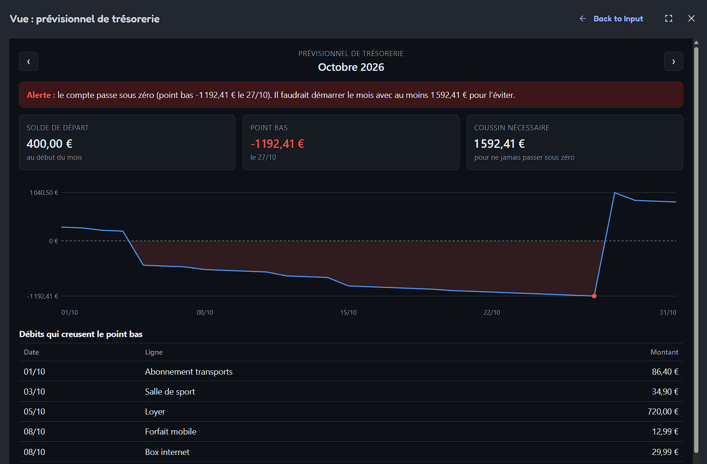
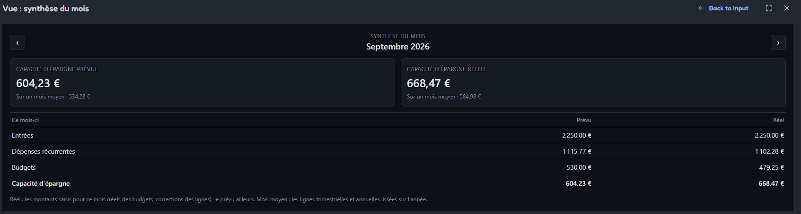
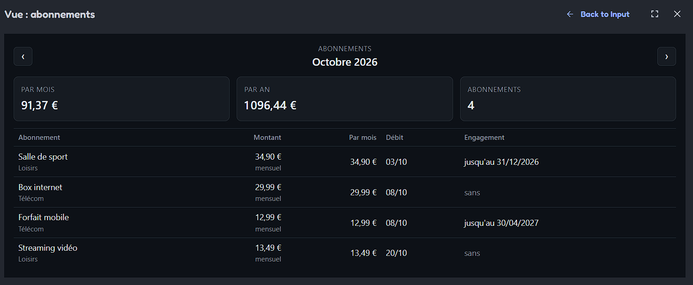

# hestia-room-finance

[](https://github.com/alexismoreaullobera/hestia-room-finance/actions/workflows/ci.yml)
[](https://github.com/alexismoreaullobera/hestia-room-finance/actions/workflows/codeql.yml)
[](https://github.com/alexismoreaullobera/hestia-room-finance/actions/workflows/gitleaks.yml)
[](LICENSE)

The **personal finance room** of Hestia: plan the incomes and expenses of each month, forecast the low point of the account, compare plan and actuals, and track subscriptions, with no bank connection. Hestia is a personal AI assistant built from standalone "rooms", one per area of life. Each room is a self-contained application that also exposes an **MCP server** (Model Context Protocol): tools an AI agent can call, and **widgets** (MCP Apps) a host can display.



> **Status: in progress.** The business core, its persistence (SQL Server, EF Core), the four read-only **data tools**, the three **views** (MCP Apps widgets) and the first **input** (the starting balance of the month, edited in place in the cash flow forecast view) are done and tested, on a fictitious demo plan. The other inputs (actuals of the month, then recurring lines, subscriptions and budgets) come next. The v1 features are defined in the [scope](docs/scope.md).

## Features

**Business core** (`Hestia.Room.Finance.Domain`, pure C#):
- **Monthly plan**: recurring incomes and expenses (monthly, quarterly, yearly), subscriptions with their end of commitment, budgets for variable expenses.
- **Month summary**, planned and actual, in two readings: **cash** (what falls due this month) and **smoothed** (a 360 € yearly insurance weighs 30 € every month), with the savings capacity.
- **Cash flow forecast**: the expected balance of the account day by day, its **low point**, the **cash buffer** the month needs, an **alert** below zero, and the **contributing debits** (which debit to move).
- Amounts in euros with cents, every object valid once created.

**Persistence** (`Hestia.Room.Finance.Infrastructure`): SQL Server with EF Core, persistence models separate from the domain, versioned migrations, a reader that loads a month as domain objects, a writer that saves the inputs (domain objects only, so every value has passed the business rules), and a fictitious demo plan.

**MCP server** (`Hestia.Room.Finance.Mcp`): Streamable HTTP (stateless), read-only tools for the agent:

| Tool | What it returns |
|---|---|
| `get_month_summary` | Planned and actual summary: incomes, recurring expenses, budgets, savings capacity (cash and smoothed) |
| `get_cash_flow_forecast` | Day-by-day forecast: low point, cash buffer, alert below zero, contributing debits |
| `list_recurring_lines` | Recurring lines of the month, with their date in the month and monthly equivalent |
| `list_subscriptions` | Subscriptions with their monthly and yearly cost, commitment end, and the totals |

Each tool takes an optional `month` (`YYYY-MM`, the current month in Paris time by default) and returns a **text summary** in French (for the model and hosts without UI) plus **structured content** with an advertised output schema.

**Views** (MCP Apps): each view tool is its data tool plus a `ui://` widget that MCP Apps hosts render with the result; a host without UI shows the text summary.

| View tool | Widget | What it shows |
|---|---|---|
| `show_month_overview` | `ui://finance/month-overview.html` | Savings capacity planned and actual (cash and on an average month), incomes, recurring expenses, budgets |
| `show_cash_flow_forecast` | `ui://finance/cash-flow-forecast.html` | Alert, starting balance, low point, cash buffer, daily curve (hand-made SVG), contributing debits |
| `show_subscriptions` | `ui://finance/subscriptions.html` | Monthly and yearly totals, each subscription with its debit of the month and its commitment end |

The views follow the host theme (light or dark), change month with their own tool (previous and next buttons, through `callServerTool`, without going through the agent), and never write HTML from data (text only, attributes through an allowlist). The cash flow forecast view edits the starting balance in place: the forecast is redrawn from the answer of the server.

**Input tools**: the writes of the user, called by the views, never offered to the model (the agent has no write access in the v1).

| Input tool | Called by | What it does |
|---|---|---|
| `set_starting_balance` | Cash flow forecast view | Saves the starting balance of a month (negative if the account is already overdrawn), then returns the forecast recalculated, exactly as `get_cash_flow_forecast` |

An input tool is declared with the MCP Apps visibility `app`: hosts hide it from the model and let the views call it. Its month is required (a write never falls back on the current month), and a value breaking a rule of the domain (cents, at most 999 999 999,99 € either way) is a tool error, with nothing written.

**Views project** (`Hestia.Room.Finance.Views`): TypeScript built with Vite and `vite-plugin-singlefile` into one self-contained HTML per view, the MCP Apps SDK (`@modelcontextprotocol/ext-apps`) included: no CDN, no third-party code loaded at runtime, and a CSP that declares no domain (no network access from a view; the requests to the host, such as opening a link, remain governed by the host). `dotnet build` builds the views and embeds them in the MCP server.

| Month overview | Subscriptions |
|---|---|
|  |  |

## Architecture

```
Hestia.Room.Finance.Mcp             MCP server: tools and views (ASP.NET Core, MCP Apps)
        │ uses
Hestia.Room.Finance.Infrastructure  SQL Server through EF Core: persistence rows, conversions
        │ depends on
Hestia.Room.Finance.Domain          business rules and calculations, pure C#: no database, no MCP, no clock
```

- **Dependencies point inward**: the domain depends on nothing; the infrastructure depends on the domain, never the reverse.
- **Persistence models are separate from the domain**: EF Core maps plain rows (`Rows/`), converted explicitly to domain objects, so storage constraints never leak into the business rules, and an invalid row is rejected on read.
- **Calculations are done by the code, never by the LLM**: tools compute, the agent explains.
- **Thin tools**: a tool loads one month through the reader, then projects it into its output; an input tool builds the domain object (which checks the value), saves it through the writer, then returns the view data read back. The reader and the writer are injected per HTTP request (scoped, with their DbContext), the clock is a singleton.

## Quickstart

**Prerequisites:** [.NET 10 SDK](https://dotnet.microsoft.com/download/dotnet/10.0) (the exact version is pinned in `global.json`), [Docker](https://www.docker.com/products/docker-desktop/) (local SQL Server and database tests) and [Node.js 24](https://nodejs.org/) (to build the views, run by `dotnet build`, and for the MCP Inspector).

1. Clone, then choose a password for the local SQL Server (the `.env` file is never committed):
   ```bash
   git clone https://github.com/alexismoreaullobera/hestia-room-finance.git
   cd hestia-room-finance
   cp .env.example .env
   ```
   Then edit `.env`: at least 8 characters, with 3 of uppercase, lowercase, digit and symbol.
2. Start SQL Server (bound to `localhost` only, data kept in a Docker volume):
   ```bash
   docker compose up -d
   ```
3. Give the server its connection string, once, in the .NET user secrets (stored in your user profile, outside the repository). The password is typed at a hidden prompt, so it never lands in the shell history, and goes through the standard input (`printf` is a shell builtin), so it never shows in the process list either:
   ```bash
   read -rsp "SQL Server password: " SA_PASSWORD && echo
   printf '{"ConnectionStrings:Finance":"Server=127.0.0.1,1433;Database=HestiaFinance;User Id=sa;Password=%s;Encrypt=True;TrustServerCertificate=True"}' "$SA_PASSWORD" | dotnet user-secrets set --project src/Hestia.Room.Finance.Mcp
   unset SA_PASSWORD
   ```
   The password is written into JSON and into a connection string: it must not contain `"`, `\` or `;`.
4. Run the server:
   ```bash
   dotnet run --project src/Hestia.Room.Finance.Mcp
   ```
   In Development, it applies the migrations and seeds the fictitious demo plan into an empty database at startup (never in production, where the deployment pipeline migrates). The MCP endpoint listens on `http://localhost:5135/mcp`.
5. In another terminal, start the [MCP Inspector](https://github.com/modelcontextprotocol/inspector):
   ```bash
   npx @modelcontextprotocol/inspector
   ```
6. In the Inspector, connect with transport **Streamable HTTP** and URL `http://localhost:5135/mcp`. In the **Apps** tab, open `show_cash_flow_forecast`: the demo shows the alert of the current month; the arrows change month, and **Modifier** on the starting balance card changes it (try the cash buffer: the alert goes away). The **Tools** tab calls the data tools, such as `get_month_summary`.

`docker compose down` stops the database and keeps the data; `docker compose down -v` deletes it.

## Migrations

The server migrates its database at startup in Development. To apply the migrations by hand, or to add one, use the `dotnet-ef` version pinned in `dotnet-tools.json`, with the connection string in the `HESTIA_FINANCE_CONNECTION` environment variable (never written in the code), set for that one command only:

```bash
dotnet tool restore
```
```bash
read -rsp "SQL Server password: " SA_PASSWORD && echo
HESTIA_FINANCE_CONNECTION="Server=127.0.0.1,1433;Database=HestiaFinance;User Id=sa;Password=$SA_PASSWORD;Encrypt=True;TrustServerCertificate=True" dotnet ef database update --project src/Hestia.Room.Finance.Infrastructure
unset SA_PASSWORD
```

## Tests

**Docker must be running**: the infrastructure and MCP tests start a throwaway SQL Server with Testcontainers.

```bash
dotnet test
```

The views have their own tests and lint (also run by the CI):

```bash
cd src/Hestia.Room.Finance.Views
npm ci
npm run lint
npm run typecheck
npm test
```

- **Domain**: every calculation rule of the [scope](docs/scope.md), with business-named tests; sensitive rules checked by mutation.
- **Infrastructure**: domain ↔ row conversions and the schema checked offline from the EF Core model; then, on a real SQL Server (Testcontainers, one fresh migrated database per test): migrations, round trip of every entity, constraints, cascades, the month reader, the writer (create, replace in the same row, other months untouched) and the demo seeder.
- **MCP server**: unit tests of the tool outputs and text summaries on plans built in memory, of the month argument and of the clock (month change in Paris time); then end-to-end tests on the `/mcp` endpoint with an in-memory server, a real SQL Server and a fixed clock: the four data tools (annotations, output schema, figures equal to the domain applied to the demo plan, tool errors), the three view tools (their `ui://` link, a result equal to their data tool, valid and invalid months), the input tool (visibility `app`, hints, a result equal to the data tool after the save, invalid calls with nothing written), only the input tools hidden from the model and only they writing, the views (MIME type, self-contained: nothing loaded from outside, a CSP with no domain; each one mentions exactly its own tools), and host filtering.
- **Views** (Vitest with happy-dom, the SDK replaced by a fake one): formats, amounts typed in French and month navigation, `startView` (loading, tool errors, failed calls and connection, host theme, re-render on a width change only, input calls with the same guard as the navigation), the starting balance form (sent arguments, refused input, form kept open on a refusal, cancel), text never written as markup and attributes outside the allowlist refused, the chart edge cases, and the three views rendered on JSON fixtures that a C# test keeps equal to the structured content of the tools. ESLint (with `eslint-plugin-no-unsanitized`) forbids every way of turning a string into markup or code.

Tests use xUnit v3 on the Microsoft Testing Platform (declared in `global.json`).

## Contributing

Every change goes through a pull request: `main` is protected, and the CI (build and tests), CodeQL and the secrets scan must pass before merging (squash merge only).

**Enable the local secrets check once per clone** (a git hook that blocks a commit containing a secret):

1. Install [gitleaks](https://github.com/gitleaks/gitleaks):
   - Windows: `winget install Gitleaks.Gitleaks`
   - macOS: `brew install gitleaks`
   - Linux: see the [releases](https://github.com/gitleaks/gitleaks/releases)
2. Point git to the versioned hooks:
   ```bash
   git config core.hooksPath .githooks
   ```

## Project structure

```
.
├─ src/
│  ├─ Hestia.Room.Finance.Domain/          business rules and calculations
│  ├─ Hestia.Room.Finance.Infrastructure/  EF Core: DbContext, Configurations/, Rows/
│  ├─ Hestia.Room.Finance.Mcp/             MCP server: Tools/ (and Outputs/), Time/, Views/ (serves the built views)
│  └─ Hestia.Room.Finance.Views/           MCP Apps views: TypeScript (src/, shared/ kit), HTML entries (views/), tests (test/)
├─ tests/                                  one test project per project above, plus Hestia.Room.Finance.Testing (shared SQL Server fixture)
├─ docs/                                   scope and technical notes
├─ docker-compose.yml                      local SQL Server (password in .env, see .env.example)
├─ dotnet-tools.json                       pinned .NET tools (dotnet-ef)
├─ .github/                                CI, CodeQL, secrets scan, Dependabot
├─ .githooks/                              versioned git hooks
└─ Directory.Build.props                   settings shared by every project (vulnerable dependencies fail the build)
```

## Documentation

- [Finance room v1 scope](docs/scope.md): purpose, glossary, data model, calculation rules, views and tools.
- [Spike T1: MCP Apps in C#](docs/spike-mcp-apps.md): how the widget pipeline works, findings and pitfalls (the spike widget was replaced by the v1 views in T7).

## Security

This is a local development build: the MCP endpoint has **no authentication yet** and must not be exposed as is. The input tools are hidden from the model by the hosts (visibility `app`), but **this is not access control**: any MCP client reaching the endpoint can call them. Every value still goes through the rules of the domain before being saved. The hardening planned before any deployment is tracked in [#2](https://github.com/alexismoreaullobera/hestia-room-finance/issues/2).

Found a vulnerability? Please report it privately, see [SECURITY.md](SECURITY.md).

## License

[MIT](LICENSE)
