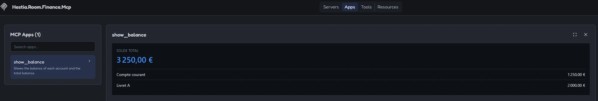

# Spike T1: MCP Apps in C#

> Ticket: [#1](https://github.com/alexismoreaullobera/hestia-room-finance/issues/1) · Date: October 2026 · Status: **done, feasibility confirmed**

## Goal

Prove that a C# MCP server can expose a **view tool** together with its **`ui://` widget**, and that an MCP Apps host renders it. This was the main technical risk of Hestia: the shell (Angular) and every room rely on this mechanism.

## Result

The `show_balance` widget, served by the C# server and rendered by the [MCP Inspector](https://github.com/modelcontextprotocol/inspector) (**Apps** tab):



The same tool call returns:
- a **text summary** (`content`), self-sufficient for the model and for hosts without UI (voice-only mode);
- **structured data** (`structuredContent`), used by the widget, so no text parsing on the view side.

## Stack

| Component | Version |
|---|---|
| .NET | 10 (SDK 10.0.402) |
| `ModelContextProtocol.AspNetCore` | 2.2.0 |
| `ModelContextProtocol.Extensions.Apps` | 2.2.0 (types marked experimental: `MCPEXP003`) |
| `@modelcontextprotocol/ext-apps` (widget side, loaded from unpkg) | 2.0.3 |
| `@modelcontextprotocol/inspector` (test host) | 2.11.0 |
| MCP protocol version (agreed during `initialize`) | 2025-11-25 |
| Transport | Streamable HTTP, stateless |

## How it works

```mermaid
sequenceDiagram
    participant H as MCP Apps host (MCP Inspector, later the Hestia shell)
    participant S as C# MCP server (:5135/mcp)
    participant W as Widget (sandboxed iframe)
    H->>S: initialize (host declares UI support)
    H->>S: tools/list
    S-->>H: show_balance + _meta.ui.resourceUri = ui://finance/balance.html
    H->>S: tools/call show_balance
    S-->>H: content (text) + structuredContent {accounts, total}
    H->>S: resources/read ui://finance/balance.html
    S-->>H: HTML + mimeType text/html;profile=mcp-app + _meta.ui.csp
    H->>W: mounts the HTML in a sandboxed iframe, applies the CSP
    W->>H: app.connect() (handshake over postMessage)
    H->>W: tool result
    W->>W: ontoolresult renders the balances
```

Key point: **the widget never talks to the server directly.** The host fetches everything and relays it to the iframe.

### Where `_meta.ui` appears

| MCP message | `_meta.ui` content | Produced by |
|---|---|---|
| `tools/list` (tool definition) | `resourceUri`: which view renders this tool | `[McpAppUi]` + `.WithMcpApps()` |
| `resources/list` (resource definition) | `csp`: external domains the view may load | `McpServerResourceCreateOptions.Meta` |
| `resources/read` (resource contents) | `csp` again, on the returned HTML | `TextResourceContents.Meta` |
| `tools/call` (tool result) | none: the result only carries `content` and `structuredContent` | |

### Server side (C#)

| Code | Effect |
|---|---|
| `.WithTools<FinanceViewTools>()` | Registers the `[McpServerTool]` methods of the class (explicit list, see pitfalls) |
| `[McpAppUi(ResourceUri = "ui://finance/balance.html")]` | Adds `_meta.ui.resourceUri` to the **tool definition** (`tools/list`), not to the result |
| `.WithResources(FinanceViewResources.Create())` | Serves the `ui://` resource: HTML + MIME type + CSP metadata |
| `.WithMcpApps()` | Declares the MCP Apps extension and processes the `[McpAppUi]` attributes |
| `CallToolResult { Content, StructuredContent }` | Text for the model, JSON for the widget |
| `<EmbeddedResource Include="Views\*.html" />` | The view is embedded in the assembly and read once at startup |

### Widget side (`Views/balance.html`)

1. Imports `App` from `https://unpkg.com/@modelcontextprotocol/ext-apps@2.0.3/app-with-deps` (ES module).
2. Registers `app.ontoolresult` **before** calling `await app.connect()`, so an early result is not missed.
3. Reads `result.structuredContent` (unless `result.isError`) and renders with `textContent` only.

## Findings and pitfalls

1. **Namespace not documented.** `[McpAppUi]`, `McpApps` and `WithMcpApps()` live in `ModelContextProtocol.Extensions.Apps` (found in the package XML documentation).
2. **`WithTools(typeof(X))` compiles but registers nothing.** A single `Type` is not an `IEnumerable<Type>`, so the call binds to the generic overload `WithTools<TTarget>(TTarget target)` with `TTarget = System.Type`: the SDK looks for tools on `System.Type` itself. No warning, `tools/list` answers "method not available". Use `WithTools<FinanceViewTools>()`.
3. **A `static` class cannot be a generic argument** (CS0718), hence a regular class holding static tool methods (same as the SDK samples).
4. **`McpApps.SetResourceUi` does not publish the CSP for a direct resource.** It sets the metadata on the resource *template*, which is not exposed for a non-template resource: `resources/list` and `resources/read` had no `_meta.ui`. Workaround: set `_meta.ui` explicitly, both in `McpServerResourceCreateOptions.Meta` (for `resources/list`) and in the returned `TextResourceContents.Meta` (for `resources/read`). Worth reporting upstream to [csharp-sdk](https://github.com/modelcontextprotocol/csharp-sdk).
5. **Every external domain must be declared in the CSP** (`_meta.ui.csp.resourceDomains`), otherwise the host blocks it. Here: `https://unpkg.com` for the App SDK.
6. **`GET /mcp` returns 405 in stateless mode.** Expected: the GET opens an SSE stream for server-initiated messages, which a stateless server does not provide.
7. **`<NoWarn>$(NoWarn);MCPEXP003</NoWarn>`**: append to the existing list instead of overwriting it.
8. **The MCP Inspector renders MCP Apps** (Apps tab, version 2.x): no dedicated host is needed to test a widget locally.

## Security notes

- **Explicit tool registration** (least privilege) instead of `WithToolsFromAssembly()`: a tool is exposed only if it is listed.
- **`ReadOnly = true`** on `show_balance` (`readOnlyHint` annotation).
- **`AllowedHosts: localhost`** in `appsettings.Development.json`: protects the local server against DNS rebinding. The real host name will be provided per environment at deployment (#2).
- **CORS limited to development** and to the configured origins only (`Cors:DevMcpHostOrigins`), for browser-based hosts that call the server directly (e.g. the future Hestia shell). Never `AllowAnyOrigin`. The Inspector does not need it: it connects to the server from its own local backend, not from the browser.
- **Widget renders with `textContent`, never `innerHTML`**: tool data is treated as untrusted (XSS, prompt injection).
- **Sandboxed rendering**: MCP Apps hosts render the view in a sandboxed iframe, so it cannot reach the host page.

## How to reproduce

1. Run the server:
   ```bash
   dotnet run --project src/Hestia.Room.Finance.Mcp
   ```
2. Start the MCP Inspector:
   ```bash
   npx @modelcontextprotocol/inspector
   ```
3. Connect with transport **Streamable HTTP** and URL `http://localhost:5135/mcp`.
4. **Apps** tab: select `show_balance`, the widget is rendered.
5. Protocol details (right panel, network log):
   - `tools/list`: `show_balance` with `_meta.ui.resourceUri`;
   - `tools/call`: `content` (summary) + `structuredContent`;
   - `resources/read` on `ui://finance/balance.html`: the HTML with `mimeType` `text/html;profile=mcp-app` and `_meta.ui.csp`.

## Limits and open questions

- **Experimental API**: `MCPEXP003` types may change. Pin package versions and re-check on each upgrade.
- **CDN dependency**: the widget needs internet access to unpkg at render time. To fix before production (#2): bundle the SDK into the view, no external domain, stricter CSP.
- **Host theme not used yet**: the widget follows `prefers-color-scheme`, not the host context (`onhostcontextchanged`, `applyDocumentTheme`).
- **Not tested yet**: Claude Desktop as a host, tool arguments (`show_balance` has none), app-only tools (`Visibility = App`), view-to-server calls.
- **No automated tests yet** (ticket T2).

## Next steps

- **T2**: repository foundation (CI, first tests, secret scanning, branch protection).
- **T3**: `room://manifest` and first draft of the room contract, based on these findings.
- **T5**: Hestia shell as an MCP Apps host.
- Follow-ups from the reviews: #2 (security before production), #3 (room foundations).
